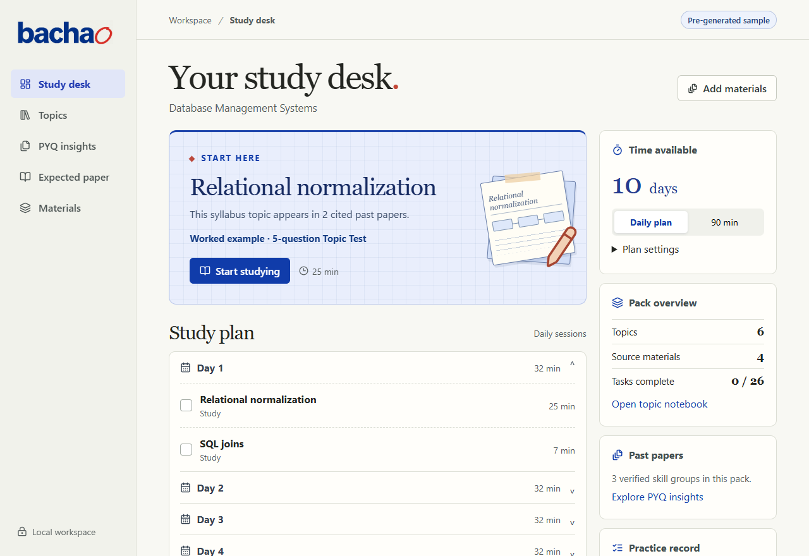

# Bachao

Before a DBMS exam, it’s possible to have the syllabus, a folder of notes and years of question papers, and still spend the first hour deciding where to start. **Bachao gives you a first study block** with a topic, a reason to study it and a time budget. Change the time available and the same pack becomes a different plan.

Bachao is a free exam-prep app that runs on your PC. You can try the complete study flow with the built-in DBMS sample, then use a local model to build a pack for your own subject. There’s no account, API key or subscription.

[Quick start](#quick-start-on-windows) · [Bring your own materials](#bring-your-own-materials) · [Study plans](#how-the-plan-changes) · [Practice papers](#past-papers-and-the-expected-paper) · [Troubleshooting](#troubleshooting) · [Development](#development-and-checks)



## Quick start on Windows

**To try the sample**, you need Windows, Node.js 22.14 or later, and a current Edge or Chrome browser. The commands below use PowerShell and Git. If you downloaded the repository as a ZIP or already have a checkout, open PowerShell in the folder containing `package.json` and start at step 2.

1. Get the project.

   ```powershell
   git clone https://github.com/anurag-05-cmd/bachao.git
   cd bachao
   ```

2. Install the locked dependencies, build the app and start it.

   ```powershell
   npm.cmd ci
   npm.cmd run build
   npm.cmd start
   ```

3. Open **http://127.0.0.1:5173**. On first launch you’ll see **Pre-generated sample** above the DBMS desk. Select **Start studying** to open the normalization notebook, or **90 min** to see what you could cover this evening.

Keep PowerShell open while studying. Press `Ctrl+C` to stop Bachao. For your next session, run `npm.cmd start` from the project folder and open the same address in the same browser profile. If you need Node.js, install it with `winget install --id OpenJS.NodeJS.LTS --exact` and reopen PowerShell.

### Enable generation for your own subject

Install Ollama on the same PC with the following PowerShell command or the official Windows installer. [Ollama for Windows](https://docs.ollama.com/windows)

```powershell
winget install --id Ollama.Ollama --exact
```

Open Ollama from the Start menu. In a fresh PowerShell window, download the default model and check that its name appears in the list. The download is about 2.5 GB. [Qwen model details](https://ollama.com/library/qwen3:4b-instruct)

```powershell
ollama pull qwen3:4b-instruct
ollama list
```

If the runtime is installed but stopped, run `ollama serve` in a separate terminal. To try a different installed model, enter its exact name under **Materials → Local Ollama model**.

## Bring your own materials

Open **Add materials** from the desk. Each category accepts selectable-text PDFs and pasted text. A syllabus is enough to begin.

| Material | What it contributes | How to add it |
| --- | --- | --- |
| **Syllabus** | Topics to study and the scope of the pack. Every generated topic needs a syllabus citation. | Upload the syllabus or paste the relevant unit with the subject name. |
| **Notes & slides** | Explanations, examples and evidence for test questions. | Add one or more handouts, or paste a named excerpt. |
| **Previous-year papers (PYQs)** | Historical questions, recurring skills and evidence for a practice paper. | Add each paper as a separate file or paste entry. Keep visible years, marks and section instructions. |

1. Expand a filename under **Source pages**. Check how many pages were read and whether the extracted text makes sense. Each PDF can be up to 50 MB. For scans or equations that extracted poorly, use **Paste text** and include the original filename and page number in the source name. Pasted text becomes one source page.
2. Enter the **exam date** and **study minutes per day** you can actually spare. Select **Build my study pack**. If analysis fails, the error appears beside **Retry analysis** and the draft stays available.
3. On the desk, follow **Start here**. For a claim you want to check, open **Source evidence** in the topic notebook, select the citation and choose **Read source page**.

**What gets read?** PDF extraction runs page by page. The first model request uses up to 1,100 characters from each of the first five readable syllabus pages, three notes pages and two paper pages. It builds up to six topics. **Materials → Saved study packs → Analysis coverage** shows which pages and how much text went into that first pass. For a unit deep in a long booklet, paste that unit as the syllabus for a new pack.

## How the plan changes

Bachao schedules study, practice and revision in code. Switching plans uses saved topics and makes no model request. Here’s how the six-topic DBMS sample uses each budget.

| | Daily plan with 10 available study dates | 90-minute session |
| --- | --- | --- |
| First action | Study relational normalization for 25 minutes with a worked example. | Read compact normalization notes for 18 minutes. Expand the example if needed. |
| Practice | A five-question Topic Test is the suggested check. | A three-question Quick Check is the suggested check. |
| Coverage | Study, practice and revisit all six topics across the available dates. | Cover two topics in 66 scheduled minutes. The desk names the four deferred topics. |

The daily plan counts **today and exam day**. An exam tomorrow gives you two available dates. At 45 minutes per day that’s 90 minutes total, which also activates compact study. The separate **90 min** switch puts the work into one session. A time budget is a ceiling, so a plan can finish with minutes to spare.

### Inside a topic

- **Short Notes** and **Important Points** explain the concept. The worked example shows it in use, and **In the exam** outlines a written answer. **Watch** opens a YouTube search for the subject and topic in a new tab.
- **Test Me** offers up to three questions in a Quick Check or five in a Topic Test, depending on the source material. Bachao scores multiple-choice answers immediately. For a written answer, compare it with the marking points and choose **Met the marking points** or **Needs review**.
- After a miss, read the explanation and its source. **Retry missed questions** gives you just those items. **Show my next block** brings forward a revision block for that topic when one fits the plan. Completed tasks and submitted attempts survive a reload.

## Past papers and the expected paper

**PYQ insights** groups questions by the skill they test. Two differently worded questions asking you to decompose a relation can count toward the same skill. Identifying a key in that relation tests a different skill. Open **Read source page** to see the historical wording highlighted in context. Bachao checks the quote against the extracted text and counts distinct papers. Renamed copies with identical normalized text count once. Ambiguous years and missing marks appear as unknown.

**Expected paper** builds a **PYQ-based practice paper** with original questions and marking guides. It can reproduce sections, marks and choices when at least two distinct papers show a consistent, readable structure. In the DBMS sample you attempt one of two 5-mark questions and one required 8-mark question, for **13 marks**. If the sources leave the format unclear, you get a practice set covering the verified skills. Historical frequency describes the papers you supplied. It cannot predict the next exam.

## What stays on your PC

PDF.js extracts text in the browser. When you ask for new material, Bachao’s local Node endpoint sends excerpts to Ollama at `127.0.0.1:11434`. Uploaded text is treated as study material. The server validates the response format, checks references against source pages and rejects invalid results. A matching citation confirms where an excerpt came from. Check the cited page when evaluating a generated explanation or answer key.

| When you do this | What happens |
| --- | --- |
| Build a pack with a new set of materials or a different model | Ollama generates a compact topic map. A successful pack is cached for that combination of model and sources. |
| First request a topic test, analyse paper excerpts or generate a practice paper | The app prepares the requested material on demand and saves successful results. Completed paper excerpts and practice questions can be reused after a retry. |
| Reopen a saved pack, change your time budget, score an answer or retry missed items | The browser uses saved data and local calculations. |

IndexedDB stores the uploaded PDFs, extracted text, packs, settings and quiz progress in the browser profile for the address you used. **Delete pack** removes the chosen pack and its attempts while keeping the upload draft. **Delete all local study data** also clears drafts and uploaded copies after confirmation. Your original files stay in their folders. After dependencies and model weights are installed, the core study flow works offline. Opening a YouTube search uses the internet.

## Repeat the DBMS walkthrough

From the project folder, run `npm.cmd run demo:files` to create four original synthetic PDFs in `.cache/reel/`. These files let anyone demonstrate uploading materials without using personal notes or real exam papers.

1. In **Materials**, upload the syllabus, notes and two papers in their matching fields. Expand a filename to show a page. **Build my study pack** takes these inputs through live Ollama generation. For the repeatable offline demo, choose **Start fresh recording sample**.
2. Show normalization on the ten-day desk, select **90 min**, then open **Read compact notes → Jump to Test Me → Quick Check · 3**.
3. Pick **Make building part of every key** for the first question and **A room determines its building** for the second. Write the Booking and Room relations for the third. Submit, check the written answer, then select **Show my next block**. The desk gives you an eight-minute revision block for the missed concept.
4. Open **PYQ insights → Decompose a relation using dependencies → Read source page**. Compare the highlighted 2023 question with the 2024 paraphrase. Finish in **Expected paper → Generate practice paper** and reveal a marking guide.

The **Pre-generated sample** label identifies this walkthrough throughout. Starting a fresh recording sample again resets its history after confirmation and keeps the uploaded draft.

## Troubleshooting

| Symptom | What to try |
| --- | --- |
| `npm.cmd ci` reports `EPERM` on Windows | Stop any running Bachao dev or preview server with `Ctrl+C`, then retry the install. |
| Port 5173 is in use | Use the existing Bachao window or stop the previous server before starting another. |
| **Cannot reach Ollama** or **Model missing** | Start Ollama, run `ollama list`, and compare the installed name with the model field. Pull the model if needed, then retry. |
| Analysis times out or a source reference fails validation | Each model request has a four-minute limit. Narrow the syllabus to one named unit with clear source text and retry. |
| A scanned paper has empty pages | Bachao reads existing PDF text. Paste a checked transcription of the questions and identify the source pages. |
| A saved pack seems to have disappeared | Reopen the same browser profile and address. Using `localhost` in place of `127.0.0.1`, switching ports, or clearing browser storage changes which workspace you see. |

## Development and checks

Use `npm.cmd run dev` for the development server. Both development and production preview serve the app and its local API on port 5173. For browser checks, build the production bundle first. Each check starts a temporary local server and uses an isolated browser profile.

| Command | What it exercises |
| --- | --- |
| `npm.cmd test` | Page extraction, scheduling, scoring, source verification, duplicate papers and marks arithmetic. |
| `npm.cmd run build` | Production frontend and bundled PDF worker. |
| `npm.cmd run test:browser` | Desktop and portrait UI, sample, retry, persistence, deletion and offline requests. |
| `npm.cmd run test:upload` | Four synthetic PDFs through real extraction, plus reproducible model-error and recovery fixtures. |
| `npm.cmd run test:reel` | The portrait DBMS sequence from upload to missed answer and highlighted historical source, with zero inference requests. |
| `npm.cmd run test:ollama` | A genuine syllabus-only request through the running app. Start Bachao and Ollama and install the model first. |

The checks use installed Edge by default. In PowerShell, set `$env:BACHAO_BROWSER='chrome'` to use installed Chrome, or `$env:BACHAO_CAPTURE='1'` to save synthetic screenshots from the browser and reel checks in `.cache/qa/`. Set `$env:BACHAO_TRY_LIVE='1'` for a real-model attempt during the upload check, or `$env:BACHAO_MODEL` to select another installed model for `test:ollama`.

**Observed CPU performance.** On a Windows 11 laptop with an i5-13500H and 16 GB RAM, the default model produced a first study block on *Spectra of Sampled Signals* in 90 seconds from a short, subject-labelled syllabus excerpt. A broader Signals and Systems request hit the four-minute timeout, and a shorter retry failed syllabus-citation validation. The corresponding feature walkthrough used a reviewed, prepared pack and showed the successful live excerpt separately. Input size and subject context both mattered in these runs.

### Where the code lives

| Part | Entry point |
| --- | --- |
| React screens, uploads and saved packs | [Workspace](src/Workspace.jsx) · [Materials](src/Materials.jsx) · [IndexedDB storage](src/db.js) |
| PDF extraction and document fingerprints | [PDF reader](src/pdf.js) · [Materials processing](src/materials.js) |
| Scheduling, quiz scoring and revision | [Study planner](src/study.js) · [Quiz logic](src/quiz.js) |
| Distinct-paper counts and practice-paper format | [Historical evidence](src/history.js) · [Paper views](src/Papers.jsx) |
| Loopback API, Ollama requests and Zod validation | [Vite integration](vite.config.js) · [Local API](server/local.js) · [Response contracts](shared/contracts.js) |
| Reproducible examples and verification | [DBMS sample](src/sample.js) · [Unit tests](tests/) · [Browser checks](checks/) |

Bachao uses Mozilla’s Apache-2.0-licensed PDF.js and Ollama’s MIT-licensed runtime. StudyAgent and StudyForge were reviewed for notes-to-quiz and review interface ideas. Bachao’s interface, fixtures and questions were written for this project. [PDF.js](https://github.com/mozilla/pdf.js) · [Ollama](https://github.com/ollama/ollama) · [StudyAgent](https://github.com/whatincode/StudyAgent) · [StudyForge](https://github.com/Sccaryboi1999/StudyForge)
